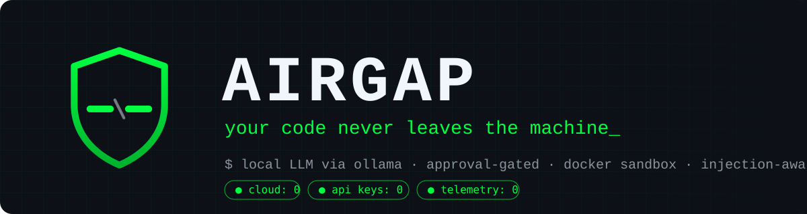
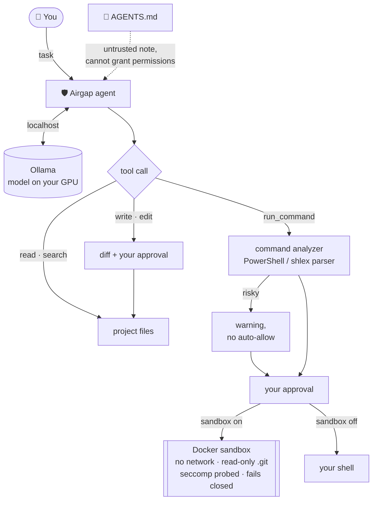

<div align="center">



A security-hardened AI coding agent that runs **100% locally** on [Ollama](https://ollama.com):
in your terminal and in VS Code. No cloud, no API keys, no telemetry.

[](https://github.com/cybergah/airgap/releases/latest)
[](https://github.com/cybergah/airgap/actions/workflows/testler.yml)
[](LICENSE)
[](#quick-start)
[](https://ollama.com)
[](#security-model)

[Quick start](#quick-start) · [Security model](#security-model) · [Benchmarks](#benchmarks) · [Contributing](CONTRIBUTING.md) · [Türkçe](README.tr.md)

</div>

---



## Why Airgap?

Cloud coding agents read your whole repository and send it to someone else's servers.
Airgap does the same job with a model running on **your** GPU, and it treats that model the
way a security engineer would: **as untrusted input**.

- 🔒 **Local by design.** Inference through Ollama on your machine. Your code, prompts and secrets stay with you.
- 🧱 **Defense in depth.** Approval gates, a command analyzer built on real shell parsers, prompt-injection-resistant project notes, and an optional network-less Docker sandbox that **fails closed**.
- 📏 **Measured, not hyped.** A 24-task benchmark with hidden tests, plus bugs planted in real open-source projects. The numbers, the confidence intervals and the caveats are published.
- 🧩 **Terminal and VS Code.** A streaming chat panel with diff views and approve/reject buttons, plus in-editor "edit this selection".

## Features

| | |
|---|---|
| **Agent loop** | Reads, edits, runs and verifies with 7 tools: `list_files`, `read_file`, `search_text`, `search_code`, `write_file`, `edit_file`, `run_command` |
| **Approvals** | Every write and every command shows a diff or the exact command line first |
| **Checkpoints** | Every turn can be undone; checkpoints live outside the project and never touch your `.git` |
| **Semantic search** | Local embeddings (`nomic-embed-text`); git-ignored files are never indexed |
| **Repo map** | The most important definitions go to the model every turn (approach adapted from Aider): Python `ast`, Tree-sitter for JavaScript, TypeScript and C#, regex fallback for everything else |
| **Selection edit** | Select code, press **Ctrl+Alt+K**, describe the change, review the diff, apply or reject |
| **Live status** | Streaming answers, visible reasoning, and a status line while the model is busy ("Model writing · 12 s") |

## Security model

Airgap assumes the model can be wrong, confused, or manipulated by the files it reads.

**Gates**
- Writing files and running commands require approval. Reading `.env`, key and credential files requires approval too, and they are never indexed or put into the repo map.
- Environment variables whose names contain `TOKEN`, `SECRET`, `PASSWORD`, `API_KEY` and similar are stripped before any command runs.
- Permission rules are read **only** from `%LOCALAPPDATA%\kod-ajani\izinler.json`. A repository cannot grant itself permissions.

**Command analyzer.** Risky commands (deletion, network, package installs, `git push`, paths outside the project) trigger a warning, and "always allow" stops working for them. Detection has two layers: pattern matching, and splitting the command with **PowerShell's own parser** (`shlex` for `sh` inside the sandbox). That catches obfuscations like ``Rem`ove-Item``, `/bin/rm`, `git -C . push` and `[IO.Directory]::Delete(...)`. Commands whose names are computed at runtime, or that cannot be parsed, are flagged.

**Prompt-injection defense.** A project's `AGENTS.md` is given to the model as an *untrusted note from the repository author*, never as rules: it cannot grant permissions or skip approvals. Notes that mention networking, secret files, risky commands or "no approval needed" raise a warning, and notes pointing outside the project or at a secret file are not read at all. This is tested against malicious files (`deneme_enjeksiyon.py`).

**Docker sandbox** (`--korumali`, or `kodAjani.korumaliCalistirma` in VS Code)
- Commands run in an unprivileged container with **no network**. The project is mounted at `/work`; `.git` and similar folders are read-only; secret files appear empty. Your disk, environment variables and the Docker socket are invisible.
- Before the first command, Airgap **actively probes** Docker's seccomp filter by attempting a forbidden syscall (`unshare`). If the probe succeeds or cannot run, every command is rejected. `/proc`'s "Seccomp" line is not trusted, because Docker Desktop reports it as enabled even when the filter is off.
- If Docker is not running or the image is missing, commands are **rejected**, never run on the host.

> **Stay local:** use a model that runs on your machine. Ollama models whose names end in `:cloud` run on remote servers, and so does any `OLLAMA_HOST` that points to another machine.
>
> **Honest limits.** Without the sandbox these rules are not a security boundary: an approved command runs with your privileges, and pattern-based detection can be bypassed. Code generated at runtime cannot be read, only flagged. Even in the sandbox the agent can modify project files, so review changes before running the code yourself.

## Benchmarks

`olcum.py` runs 24 tasks against the real model; success is judged by **tests the model never sees**, and the model's code runs in the sandbox.

| Set | Model | Result | 95% CI |
|---|---|---|---|
| 24 tasks × 3 runs (bug fixes, features, multi-file edits, questions, trap tasks) | `gpt-oss:20b` | **68/72 (94%)** | 87–98% |
| Bugs planted in real projects (click, more-itertools, cachetools) | `gpt-oss:20b` | **24/33 (73%)** | 56–85% |

Full reports: [small set](olcum-sonuclari/bitirme.md), [real projects](olcum-sonuclari/gercek-bitirme.md). Comparisons with other models (Devstral, Qwen2.5-Coder) are in [`olcum-sonuclari/`](olcum-sonuclari/).
We planted these bugs ourselves, so the numbers do not predict results on your own code.

## Quick start

**Requirements:** Python 3.10+, git, [Ollama](https://ollama.com), and for the panel, VS Code. Tested on Windows.

```bash
ollama pull gpt-oss:20b
ollama pull nomic-embed-text
git clone https://github.com/cybergah/airgap
```

**Terminal**

```bash
python airgap/kod-ajani/ajan.py --dizin /path/to/your/project
```

Chat commands: `/geri` undo the last turn · `/yeni` new chat · `/onay` toggle approvals · `/yardim` help · `/cik` quit.
One-shot mode: `--gorev "fix the failing tests" --otomatik`. Sandbox: `--korumali` (first run `docker pull python:3.13-slim`).

**VS Code**

Download `kod-ajani-<version>.vsix` from the [latest release](https://github.com/cybergah/airgap/releases/latest) and install it:

```bash
code --install-extension kod-ajani-0.10.1.vsix --force
```

The extension ships with the agent inside; you only need Python and Ollama. To build it yourself: `python airgap/kod-ajani/paketle.py` (writes `airgap/dist/`).

Open a folder and click the `</>` icon in the activity bar. Settings live under **Airgap**.

**Optional:** better repo maps for JavaScript, TypeScript and C#:

```bash
python -m pip install tree-sitter tree-sitter-javascript tree-sitter-typescript tree-sitter-c-sharp
```

## Language note

Airgap started as **Kod Ajanı**, a Turkish project. The model-facing prompts and tool definitions are in English, but the **UI, CLI messages and code identifiers are currently in Turkish**. An English interface is the most valuable contribution right now. See [CONTRIBUTING.md](CONTRIBUTING.md).

## Tests

216 unit tests plus a VS Code smoke test run on every push (Windows). Real-model benchmarks and the real VS Code window test run locally.

```bash
cd kod-ajani && python -B -m unittest discover -p "test_*.py"
node kod-ajani/vscode-eklenti/test/duman.js
```

## Contributing

Bug reports, translations, new benchmark tasks and security findings are all welcome. Start with [CONTRIBUTING.md](CONTRIBUTING.md).
Found a way around the command analyzer or the sandbox? Please report it privately, following the [security policy](https://github.com/cybergah/.github/blob/main/SECURITY.md).

## License

[MIT](LICENSE) © Cybergah

## Author

Created by **Petrus**: developer, hacker, founder of [Cybergah](https://github.com/cybergah).
[GitHub](https://github.com/delilzagros) · [X @AEVERTIS](https://x.com/AEVERTIS) · [Telegram](https://t.me/aevertis)

<div align="center">
<sub>Part of <a href="https://github.com/cybergah">Cybergah</a>, offline-first, privacy-respecting open-source tools.</sub>
</div>
